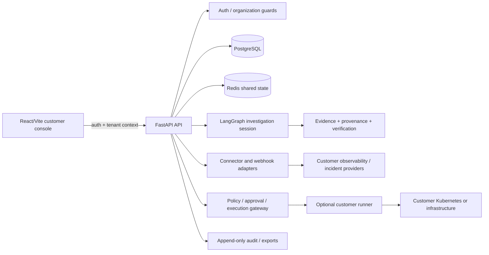

# OmniPotent master-prompt research and implementation audit

Generated 2026-10-14 from commit `a2083de721a323da07f56531ca55d9b1cf5c865e`.
This document distinguishes requirements in the supplied master prompt from
implementation evidence in the checkout. A README or route declaration is not
treated as proof of a working customer capability; evidence must be executable
code, a focused test, or a named live-environment result.

## Research conclusions applied

- Kubernetes recommends namespace-scoped Roles/RoleBindings, specific verbs and
  resources, and avoiding wildcard or cluster-admin permissions. This supports
  OmniPotent's namespace/resource/action capability boundary and the rollback
  preflight checks. [Kubernetes RBAC good practices](https://kubernetes.io/docs/concepts/security/rbac-good-practices/)
- Kubernetes service accounts should receive only the minimum permissions needed
  by the workload. This supports a separately scoped customer runner instead of
  passing broad customer credentials through the control plane. [Kubernetes service accounts](https://kubernetes.io/docs/concepts/security/service-accounts/)
- NIST's AI RMF treats trustworthy AI as a lifecycle concern covering design,
  deployment, use, and evaluation. Its Generative AI Profile emphasizes
  governance, provenance, testing, and incident disclosure; this supports
  evidence provenance, abstention, release gates, and benchmark artifacts.
  [NIST AI RMF](https://www.nist.gov/itl/ai-risk-management-framework),
  [NIST Generative AI Profile](https://nvlpubs.nist.gov/nistpubs/ai/NIST.AI.600-1.pdf)
- Kubernetes multi-tenancy guidance treats authorization and namespace isolation
  as foundational controls, not frontend concerns. This supports server-side
  tenant checks for integrations, jobs, memory, tools, and remediation.
  [Kubernetes multi-tenancy](https://kubernetes.io/docs/concepts/security/multi-tenancy/)

## Current architecture

The read-only customer path is Browser → API → organization guard → connector
or incident store → LangGraph investigation → evidence-backed report → history.
Mutation paths branch through the policy, approval, freeze, and recovery gates;
they are not part of the default read-only path.

## Implementation order

1. **Phase A — identity and tenancy:** complete live OAuth, organization role
   acceptance, and tenant-isolation tests.
2. **Phase B — onboarding:** validate connector credentials and service
   discovery against a named provider, then complete browser accessibility and
   error-state acceptance.
3. **Phase C — incident intake:** run provider webhook/permission contract
   tests and the Redis worker-restart drill.
4. **Phase D — investigations:** supply an independently labeled 30-case RCA
   corpus and run the evidence/abstention release gate.
5. **Phase E — operations:** execute staging backup/restore, load, failover,
   signed-artifact, and customer pilot evidence collection.
6. **Phase F — remediation:** only after the preceding evidence exists, run a
   named-cluster approval and recovery drill with mutation controls enabled.

## Implementation inventory

| Master-prompt area | Current evidence | Status | Remaining verification or work |
|---|---|---|---|
| React/Vite customer application | `frontend/src/App.tsx`, console, onboarding, integrations, reports, tests | PARTIAL | Full browser acceptance and responsive/accessibility pass |
| FastAPI API surface | `app/api`, versioned policy/coordinator/incident routes, Pydantic contracts | PARTIAL | Full API suite has known environment/provider failures; matching dependency collection now succeeds |
| LangGraph durable investigations | `app/graph`, session/checkpointer configuration, production PostgreSQL guard | PARTIAL | Crash/restart drill in a matching dependency environment |
| MCP observability/infrastructure tools | `app/mcp/servers`, tool gateway, provenance and tenant checks | IMPLEMENTED LOCALLY | Live provider permission/timeout contract matrix |
| Authentication, organizations, RBAC | tenant/auth stores, billing/team/admin routes, server guards, and incident-history tenant tests | PARTIAL | Live OAuth/tenant isolation acceptance |
| Onboarding and integration health | onboarding UI plus connector/configuration paths; additive status metadata exposes mode, capabilities, write boundary and freshness semantics | PARTIAL | Real provider connection tests and 15-minute usability measurement |
| Incident console/timeline/postmortems | `app/incidents`, postmortem persistence/routes, timeline/evidence paths | PARTIAL | Browser workflow and reviewer acceptance |
| Evidence and RCA uncertainty | evidence normalization/diversity, verification agent, abstention tests; four-case scorer baseline self-check passes with null and evidence-spam baselines scoring zero answer cases | IMPLEMENTED LOCALLY | Independent labeled benchmark and live telemetry validation |
| Service catalog/dependency graph | discovery, graph, blast radius, freshness/duplicate catalog validation | IMPLEMENTED LOCALLY | Live Kubernetes/Consul/mesh source validation |
| SLO/reliability | SLO math, burn-rate handling, poller and dashboard paths | IMPLEMENTED LOCALLY | Live metric backend acceptance |
| Controlled remediation | typed action results, policy gateway, approvals, kill switch, K8s rollback, recovery receipts, and fail-closed authoritative Kyverno policy decisions | IMPLEMENTED LOCALLY | Named-cluster safety/integration test before enablement |
| Customer runner | fail-closed HTTP service, exact capability validation, explicit executor injection, and separate Kubernetes deployment/service account | PARTIAL | Customer-environment integration and real scoped executor validation |
| Durable execution control | coordinator durable approval/cancel; Redis-backed planning pause/cancel | PARTIAL | Multi-replica Redis drill and worker restart evidence |
| Audit, retention, export | append-only audit, chain verification, retention purge, SHA-256 export manifest | IMPLEMENTED LOCALLY | WORM/object-lock and legal-retention drill |
| Operator annotations/memory | append-only authored revisions, tenant-scoped persistence tables, incident-workbench annotation API, and digest-linked confirmed-memory promotion | PARTIAL | Browser correction flow and live persistence/tenant acceptance |
| Evaluation/release gate | deterministic RCA scorecard, baseline anti-gaming check, artifact-aware release gate | IMPLEMENTED LOCALLY | Independently signed pilot/restore artifacts |
| Deployment/operations | configuration guards, deploy docs, health/observability paths | PARTIAL | Staging deployment, backup/restore, and production-like load evidence |

## Non-negotiable safeguards verified locally

- LLM output is not an execution authorization; typed actions go through
  deterministic policy and approval paths.
- Read-only behavior remains available independently of mutation controls.
- Kubernetes rollback requires explicit revision and rejects GitOps-owned direct
  mutation paths.
- Resource identity/version/scope/controller drift is rejected by preflight.
- Missing, stale, or non-independent evidence cannot produce a verified recovery
  receipt.
- Mutation freeze supports global and tenant scopes and a Redis-backed shared
  registry when configured.
- Exported audit trails include chain validity and a manifest digest.

## Verification boundary

The locked development environment now passes `scripts/verify_runtime.py` with
LangGraph 1.2.6, checkpoint base 4.1.1, and SQLite checkpoint 3.1.0. The full
backend run in that environment reached 4,147 passed tests, 29 skipped, 29
failures, and 30 errors. The remaining failures are concentrated in missing
provider/network configuration, sandbox socket-binding restrictions, stale
contract assertions, and live-infrastructure assumptions; they are tracked as
verification gaps rather than represented as fake success. Focused PRD safety
tests pass, including durable approval/cancel, execution control, runner
capability validation, rollback, mutation freeze, annotations, recovery
receipts, release gates, safety preflight, catalog validation, verification
independence, the 32-test incident/tenant workflow suite, and the consolidated
109-test safety/onboarding regression set. The remaining items above still require configured providers,
customer/staging infrastructure, or browser acceptance.
